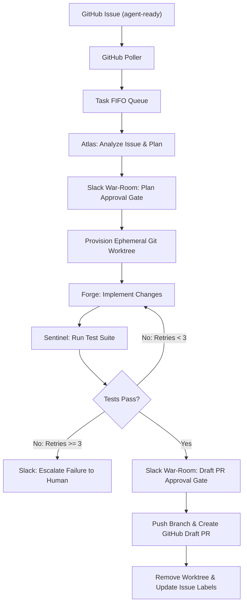

# Forge Swarm: Autonomous Multi-Agent SWE Team

An event-driven, issue-triggered autonomous multi-agent engineering swarm powered by the `google-antigravity` SDK and Slack Socket Mode. The system decomposes, implements, verifies, and delivers software tasks inside isolated Git worktrees under strict token budget governance and Slack war-room supervision.

---

## ⚡ Key Highlights

- **Zero-API-Key Architecture**: Inherits active Google AI / Antigravity subscription OAuth credentials from the host machine runtime (`LocalAgentConfig`). No paid per-token API keys required.
- **Budget-Governed Lifecycle**: Enforces token (`150,000`) and turn (`15`) limits via runtime `@post_turn` lifecycle hooks to protect against rolling subscription quota exhaustion.
- **Git Worktree Isolation**: Every task executes in a dedicated worktree (`./workspaces/issue-<id>`), leaving the host repository working copy untouched.
- **Triad Swarm Collaboration**: Specialized personas collaborating with tiered thinking depth:
  - 🧭 **Atlas (Lead Architect)**: `thinking_level="HIGH"` (Problem decomposition & spec formulation)
  - 🛠️ **Forge (Coder Sub-Agent)**: `thinking_level="MEDIUM"` (Source code authoring & git hygiene)
  - 🔬 **Sentinel (QA Sub-Agent)**: `thinking_level="MINIMAL"` (Test execution & verification reports)
  - ⚖️ **Quota Warden (Budget Guard)**: Real-time token metering and safety gates
- **Closed-Loop Self-Correction**: Sentinel tests Forge's changes and sends failure traces back into the conversation for up to 3 iterative fix cycles before escalating.
- **Slack War-Room Warping**: Single-app Socket Mode connection streaming updates under distinct agent identities via `chat:write.customize`, with Block Kit interactive approval buttons.
- **Three-Tier Observability**: Real-time Slack threads, local Streamlit inspection studio (`poc/app.py`), and SQLite state store (`storage/state.db`).

---

## 🏗️ Swarm Architecture & Workflow



---

## 📂 Repository Layout

```text
.
├── docs/
│   ├── adr/                      # Architecture Decision Records (0001–0006)
│   ├── research/                 # SWE benchmark analysis & multi-agent research
│   └── specs/                    # Implementation plan & phased PoC specifications
├── poc/
│   ├── app.py                    # Streamlit Interactive Verification Studio & Dashboard
│   ├── stage1_sdk_budget.py      # Stage 1: SDK OAuth inheritance & budget guard
│   ├── stage2_worktree_swarm.py  # Stage 2: Git worktree manager & swarm loop
│   ├── stage3_slack_war_room.py  # Stage 3: Slack Socket Mode war-room & Block Kit
│   └── stage4_e2e_pipeline.py    # Stage 4: End-to-end GitHub poller & PR delivery
├── skills/
│   ├── coder/                    # Coder sub-agent instructions & file boundaries
│   └── qa/                       # QA sub-agent test execution rules & reporting
├── src/
│   ├── agents/                   # Orchestrator, runner, lifecycle hooks & policies
│   ├── slack/                    # Bolt Socket Mode app, personas & Block Kit approvals
│   ├── storage/                  # SQLite state store, migrations & schemas
│   ├── triggers/                 # GitHub issue poller & task dispatch queue
│   ├── main.py                   # Unified production daemon (Poller + Bot + Swarm)
│   ├── pipeline.py               # End-to-end task execution pipeline
│   ├── run_bot.py                # Standalone live Slack bot runner
│   ├── schemas.py                # Pydantic models (Plans, Test Reports, Results)
│   └── worktree.py               # Ephemeral Git worktree isolation manager
├── storage/
│   ├── sessions/                 # Antigravity native conversation trajectories
│   └── state.db                  # SQLite database tracking tasks, budgets, and threads
├── tests/                        # 30 unit & integration tests
│   └── fixtures/                 # Sample repository fixture for testing
├── workspaces/                   # Ephemeral task worktrees (gitignored)
├── slack_manifest.yaml           # One-click Slack app configuration manifest
├── CONTEXT.md                    # Core project context and operating invariants
├── GLOSSARY.md                   # Canonical domain vocabulary
└── README.md
```

---

## 🧭 Documentation & Architecture Decisions

- [CONTEXT.md](CONTEXT.md): System purpose, inviolable constraints, and finalized requirements.
- [GLOSSARY.md](GLOSSARY.md): Ubiquitous domain terminology (Task, War-Room, Workspace, Safety Gate).
- [docs/specs/agent-team-implementation-plan.md](docs/specs/agent-team-implementation-plan.md): Architectural roadmap and specification.
- [docs/specs/poc-implementation-plan.md](docs/specs/poc-implementation-plan.md): 4-stage incremental verification plan.
- [docs/adr/](docs/adr/):
  - [0001: Local Subscription OAuth Runtime](docs/adr/0001-use-local-subscription-oauth-runtime.md)
  - [0002: Ephemeral Git Worktrees for Isolation](docs/adr/0002-use-ephemeral-git-worktrees-for-isolation.md)
  - [0003: Slack Socket Mode with Persona Customization](docs/adr/0003-use-slack-socket-mode-with-persona-customization.md)
  - [0004: Post-Turn Budget Enforcement Hooks](docs/adr/0004-enforce-task-budgets-via-post-turn-hooks.md)
  - [0005: Dedicated Fixture Sample Repository for Testing](docs/adr/0005-use-dedicated-fixture-sample-repo-for-testing.md)
  - [0006: Three-Tier Production Observability Architecture](docs/adr/0006-three-tier-production-observability-architecture.md)

---

## 🛠️ Prerequisites & Setup

### 1. Host Requirements
- **OS**: macOS or Linux
- **Python**: 3.11+
- **Git & GitHub CLI**: `git` installed; `gh auth status` authenticated with repository access
- **Antigravity CLI**: Active Google AI / Antigravity subscription session on the host machine (`agy` in PATH or IDE auth)

### 2. Installation
```bash
git clone https://github.com/yash/forge-swarm.git
cd forge-swarm

python3 -m venv .venv
source .venv/bin/activate
pip install -e ".[dev]"
```

### 3. Slack App Setup
1. Go to [api.slack.com/apps](https://api.slack.com/apps) → **Create New App** → **From an app manifest**.
2. Select your workspace, paste the contents of [`slack_manifest.yaml`](slack_manifest.yaml), and confirm.
3. In **Socket Mode**, generate an app-level token (`xapp-...`) with the `connections:write` scope.
4. In **Install App**, install to your workspace and copy the Bot User OAuth Token (`xoxb-...`).
5. Invite the bot to your target channel (e.g. `/invite @Antigravity Orchestrator` in `#agent-ops`).

### 4. Environment Configuration
Copy `.env.example` to `.env` and fill in your configuration:
```bash
cp .env.example .env
```

```ini
# Slack Socket Mode App-Level Token (xapp-)
SLACK_APP_TOKEN=xapp-1-...

# Slack Bot User OAuth Token (xoxb-)
SLACK_BOT_TOKEN=xoxb-...

# Target Slack Channel ID for War-Rooms
SLACK_CHANNEL_ID=C0123456789

# Optional Slack User ID to @mention on approvals
SLACK_USER_ID=U0123456789

# GitHub Target Repository (owner/repo)
GITHUB_REPO=your-org/target-repo

# Local Path to Clone of Target Repository
TARGET_REPO_PATH=/absolute/path/to/target-repo
```

---

## 🚀 Usage & Execution Modes

### 1. Interactive Streamlit Verification Studio
Launch the visual control room to inspect task states, simulate issues, review diffs, test budget guards, and monitor agent logs:
```bash
streamlit run poc/app.py
```

### 2. Unified Production Daemon
Runs the complete autonomous engineering swarm (Slack War-Room Bot + GitHub Issue Poller + Task Queue Worker):
```bash
python src/main.py
```

### 3. Standalone Slack War-Room Bot
Runs the Slack Socket Mode listener independently for handling steering replies and approval button clicks:
```bash
python src/run_bot.py
```

### 4. Phased PoC Verification Scripts
Run individual verification stages directly:
```bash
# Stage 1: SDK OAuth inheritance & budget guard early-halt
python poc/stage1_sdk_budget.py

# Stage 2: Git worktree manager & 3-retry self-correction loop
python poc/stage2_worktree_swarm.py

# Stage 3: Slack Socket Mode war-room & Block Kit approval gates
python poc/stage3_slack_war_room.py

# Stage 4: End-to-end pipeline (mock mode, zero network required)
python poc/stage4_e2e_pipeline.py --mock

# Stage 4: End-to-end pipeline (live GitHub & Slack integration)
python poc/stage4_e2e_pipeline.py
```

---

## 🧪 Testing

Run the full pytest suite (30 unit & integration tests covering budget hooks, worktree isolation, Slack Block Kit builders, personas, and orchestrator retries):
```bash
pytest -v
```

---

## 🚦 Roadmap & Implementation Status

- [x] **Repository Skeleton & Architecture Specs**: Inviolable constraints, glossary, and ADRs 0001–0006.
- [x] **Stage 1 PoC**: SDK OAuth inheritance, token metering, and `@post_turn` budget ceiling early halt.
- [x] **Stage 2 PoC**: Ephemeral Git worktree isolation, Atlas decomposition, and Forge ↔ Sentinel 3-retry self-correction loop.
- [x] **Stage 3 PoC**: Slack Socket Mode war-room, custom persona streaming (`chat:write.customize`), and interactive Block Kit approval buttons.
- [x] **Stage 4 PoC**: End-to-end GitHub issue polling (`agent-ready`), task FIFO dispatch, unified diff review, and GitHub Draft PR delivery.
- [x] **Verification Studio**: Streamlit dashboard for real-time observability, task control, and manual budget top-ups.
