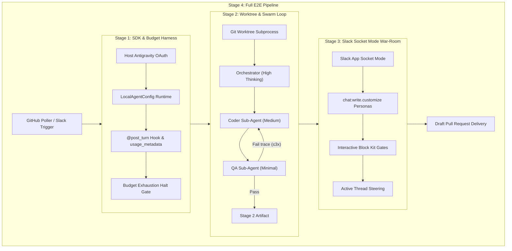

# Autonomous Multi-Agent SWE Team: 4-Stage PoC Implementation Plan

This plan operationalizes the requirements gathered in [CONTEXT.md](../../CONTEXT.md) and [docs/specs/agent-team-implementation-plan.md](agent-team-implementation-plan.md). It verifies all critical external seams incrementally before assembling the production daemon.

---

## Architecture Seams & Verification Topology

---

## Stage 1: Core SDK Harness & Budget Hook PoC ✅ [COMPLETED]

### Objective
Verify live agent execution (non-simulated LLM inference calls) via Antigravity CLI Headless Mode (`agy -p`) or `google-antigravity` with token tracking, SQLite persistence, declarative safety policies, interactive frontend verification, and deterministic halting via `@post_turn` when task budget limit is reached.

### Live & Interactive Requirements
- **Subscription Headless Inference**: PoC executes model generation calls through `agy` CLI Headless Mode (`agy -p "<prompt>" --output-format json/stream-json`), inheriting the host machine's active Google AI subscription OAuth session without requiring a `GEMINI_API_KEY`.
- **Token Telemetry Extraction**: Real prompt, thoughts, and candidate tokens are parsed from `agy` CLI JSON/NDJSON output and piped into `BudgetGuard` and SQLite.
- **Interactive Streamlit Walkthrough**: Every PoC ships an interactive Streamlit UI ([`poc/app.py`](file:///Users/yash/Documents/Repos/npc-inc/poc/app.py)) allowing the tester to trigger turns, run live inference via `agy -p`, observe real-time token burn meters, test policy evaluation on custom commands, and verify acceptance criteria visually.

### Deliverables
1. `pyproject.toml` with pinned dependencies (`google-antigravity`, `pydantic`, `streamlit`, `pytest`, `pytest-asyncio`).
2. `src/agents/agy_runner.py`: Subprocess runner driving `agy -p` in headless mode, streaming NDJSON/JSON outputs, and extracting real usage tokens.
3. `src/agents/policies.py`: Declarative safety boundaries (`allow`, `deny`, `ask_user`).
4. `src/agents/hooks.py`: `@post_turn` token metering extracting `total_token_count` into a local SQLite state store.
5. `poc/stage1_sdk_budget.py`: Executable verification script running live model turns via `agy -p` with a tight token ceiling to demonstrate real-time metering and deterministic early halt.
6. [`poc/app.py`](file:///Users/yash/Documents/Repos/npc-inc/poc/app.py): Interactive Streamlit walkthrough for visual testing and requirement verification (`streamlit run poc/app.py`).
7. `tests/test_budget_hooks.py` & `tests/test_agy_runner.py`: Unit tests verifying token accumulation, policy engine decisions, `agy` output parsing, and `asyncio.Event` pause mechanics.

### Acceptance Criteria
- [x] `pytest tests/` passes 100% (9/9 tests).
- [x] Live inference executes via `agy` CLI headless mode (`--agy`) inheriting host subscription OAuth, logging real token usage into `storage/state.db`.
- [x] Task halts deterministically with `Status: PAUSED_BUDGET` upon reaching budget ceiling.
- [x] Interactive Streamlit walkthrough ([`poc/app.py`](file:///Users/yash/Documents/Repos/npc-inc/poc/app.py)) allows user to step through turns, test policies, and verify requirements.

---

## Stage 2: Git Worktree Isolation & Multi-Agent Swarm Loop ✅ [COMPLETED]

### Objective
Verify that the host can provision and prune isolated Git worktrees (`./workspaces/issue-<id>`), coordinate sub-agents using structured Pydantic outputs (`ImplementationPlan`, `QATestReport`), and run a bounded 3-retry self-correction loop against a synthetic broken test.

### Deliverables
1. `tests/fixtures/sample_repo/`: Minimal dedicated Git testbed repository containing a Python package and a deliberately failing unit test (`test_calculator.py`).
2. `src/worktree.py`: `WorktreeManager` class wrapping `git worktree add -b fix/issue-<id>` and `git worktree remove --force`.
3. `src/schemas.py`: Pydantic schemas for `SubTask`, `ImplementationPlan`, and `QATestReport`.
4. `skills/coder/SKILL.md` & `skills/qa/SKILL.md`: Sub-agent system instructions and scoped file access limits.
5. `src/agents/orchestrator.py`: Orchestrator logic delegating to Coder and QA with tiered thinking levels (`HIGH` for Orchestrator, `MEDIUM` for Coder, `MINIMAL` for QA).
6. `poc/stage2_worktree_swarm.py`: Standalone script running an intentional bug fixture in an isolated worktree branched from `sample_repo`, observing QA failure, routing the traceback back to Coder, and verifying that the fix passes on attempt 2 or 3.
7. `poc/app.py`: Interactive Streamlit Tab 4 testbench running the live Swarm loop, worktree isolation status, diff inspector, and step-by-step persona timeline.
8. `tests/test_worktree.py`, `tests/test_schemas.py`, & `tests/test_orchestrator.py`: Unit and integration test suites.

### Acceptance Criteria
- [x] `tests/fixtures/sample_repo` serves as an isolated testbed; parent repo working tree remains untouched.
- [x] Orchestrator produces a valid `ImplementationPlan`.
- [x] QA catches the failing test on turn 1 and confirms green status after Coder fix.
- [x] Max retry count (3) is strictly enforced if tests remain failing.

---

## Stage 3: Slack Socket Mode War-Room & Block Kit Approval Gates

### Objective
Verify that the local daemon connects to Slack via Socket Mode (zero public incoming ports), streams real-time updates under distinct personas (`Atlas`, `Forge`, `Sentinel`, `Quota Warden`) in a single thread, pauses execution on safety/budget gates, and resumes when an interactive button is clicked or a text steering message is sent.

### Deliverables
1. `slack_manifest.yaml`: Ready-to-import Slack App Manifest configuring Socket Mode, `chat:write`, `chat:write.customize`, and slash commands.
2. `src/slack/personas.py`: Helper dispatching `chat_postMessage` with dynamic `username` and `icon_emoji`.
3. `src/slack/approvals.py`: Block Kit templates for `[Grant +50k Tokens]`, `[Abort Task]`, and `[Approve & Create Draft PR]`.
4. `src/slack/bot.py`: Async Slack Bolt listener mapping `thread_ts` ↔ `conversation_id` and forwarding thread replies into the active agent session.
5. `poc/stage3_slack_war_room.py`: Interactive verification script running in `#agent-ops`, posting multi-persona dialogue, presenting approval buttons, and waiting for user click.

### Acceptance Criteria
- [ ] Socket Mode connects successfully using `SLACK_APP_TOKEN` (`xapp-`) and `SLACK_BOT_TOKEN` (`xoxb-`).
- [ ] Updates appear in a single Slack thread styled as Atlas, Forge, and Sentinel.
- [ ] Clicking `[Grant +50k Tokens]` unblocks a paused task and logs the extended quota.
- [ ] Freeform text in the thread is received and returned as human steering context.

---

## Stage 4: End-to-End GitHub Issue Poller & Draft PR Delivery

### Objective
Unite all components into an automated, sequential background pipeline: poll GitHub issues labeled `agent-ready` or handle `/agent solve` Slack commands → provision worktree → execute swarm → diff review in Slack → human approves `[Approve & Create Draft PR]` → push branch and open Draft PR.

### Deliverables
1. `src/triggers/github_poller.py`: Background worker querying `gh issue list --label agent-ready` at a configurable interval.
2. `src/main.py`: Unified daemon entrypoint managing the sequential task queue and graceful shutdown.
3. End-to-end integration test against a test repository issue.

### Acceptance Criteria
- [ ] Labeling an issue `agent-ready` automatically opens a dedicated Slack war-room thread.
- [ ] Task completes fully autonomously inside an isolated worktree within budget limits.
- [ ] Interactive Slack review displays unified git diff stats.
- [ ] Approving the button pushes `fix/issue-<id>` and opens a GitHub Draft PR with the test report.
- [ ] Worktree prunes cleanly on completion.
