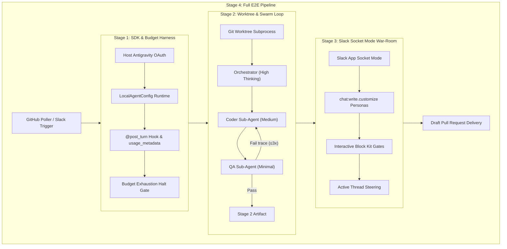

# Autonomous Multi-Agent SWE Team: 4-Stage PoC Implementation Plan

This plan operationalizes the requirements gathered in [CONTEXT.md](../../CONTEXT.md) and [docs/specs/agent-team-implementation-plan.md](agent-team-implementation-plan.md). It verifies all critical external seams incrementally before assembling the production daemon.

---

## Architecture Seams & Verification Topology

---

## Stage 1: Core SDK Harness & Budget Hook PoC

### Objective
Verify that `google-antigravity` initializes without `GEMINI_API_KEY` (inheriting the active host Antigravity Desktop OAuth session), executes a basic tool call, tracks `response.usage_metadata`, and halts cleanly via `@post_turn` when a task budget limit is exceeded.

### Deliverables
1. `pyproject.toml` with pinned dependencies (`google-antigravity`, `pydantic`, `pytest`, `pytest-asyncio`).
2. `src/agents/policies.py`: Declarative safety boundaries (`allow`, `deny`, `ask_user`).
3. `src/agents/hooks.py`: `@post_turn` token metering extracting `total_token_count` into a local SQLite state store.
4. `poc/stage1_sdk_budget.py`: Executable verification script running a synthetic task with a 5,000 token ceiling to demonstrate deterministic early halt.
5. `tests/test_budget_hooks.py`: Unit tests mocking SDK responses to verify token accumulation and `asyncio.Event` pause mechanics.

### Acceptance Criteria
- [ ] `pytest tests/test_budget_hooks.py` passes.
- [ ] `python -m poc.stage1_sdk_budget` executes with `GEMINI_API_KEY` unset, connects to local runtime, logs token consumption per turn, and halts with `Status: PAUSED_BUDGET`.

---

## Stage 2: Git Worktree Isolation & Multi-Agent Swarm Loop

### Objective
Verify that the host can provision and prune isolated Git worktrees (`./workspaces/issue-<id>`), coordinate sub-agents using structured Pydantic outputs (`ImplementationPlan`, `QATestReport`), and run a bounded 3-retry self-correction loop against a synthetic broken test.

### Deliverables
1. `src/worktree.py`: `WorktreeManager` class wrapping `git worktree add -b fix/issue-<id>` and `git worktree remove --force`.
2. `src/schemas.py`: Pydantic schemas for `SubTask`, `ImplementationPlan`, and `QATestReport`.
3. `skills/coder/SKILL.md` & `skills/qa/SKILL.md`: Sub-agent system instructions and scoped file access limits.
4. `src/agents/orchestrator.py`: Orchestrator logic delegating to Coder and QA with tiered thinking levels (`HIGH` for Orchestrator, `MEDIUM` for Coder, `MINIMAL` for QA).
5. `poc/stage2_worktree_swarm.py`: Standalone script running an intentional bug fixture in an isolated worktree, observing QA failure, routing the traceback back to Coder, and verifying that the fix passes on attempt 2 or 3.

### Acceptance Criteria
- [ ] Target repository root working tree is unchanged during and after the run.
- [ ] Orchestrator produces a valid `ImplementationPlan`.
- [ ] QA catches the failing test on turn 1 and confirms green status after Coder fix.
- [ ] Max retry count (3) is strictly enforced if tests remain failing.

---

## Stage 3: Slack Socket Mode War-Room & Block Kit Approval Gates

### Objective
Verify that the local daemon connects to Slack via Socket Mode (zero public incoming ports), streams real-time updates under distinct personas (`Atlas`, `Forge`, `Sentinel`, `Quota Warden`) in a single thread, pauses execution on safety/budget gates, and resumes when an interactive button is clicked or a text steering message is sent.

### Deliverables
1. `slack_manifest.yaml`: Ready-to-import Slack App Manifest configuring Socket Mode, `chat:write`, `chat:write.customize`, and slash commands.
2. `src/slack/personas.py`: Helper dispatching `chat_postMessage` with dynamic `username` and `icon_emoji`.
3. `src/slack/approvals.py`: Block Kit templates for `[Grant +50k Tokens]`, `[Abort Task]`, and `[Approve & Create Draft PR]`.
4. `src/slack/bot.py`: Async Slack Bolt listener mapping `thread_ts` ↔ `conversation_id` and forwarding thread replies into the active agent session.
5. `poc/stage3_slack_war_room.py`: Interactive verification script running in `#agent-ops`, posting multi-persona dialogue, presenting approval buttons, and waiting for user click.

### Acceptance Criteria
- [ ] Socket Mode connects successfully using `SLACK_APP_TOKEN` (`xapp-`) and `SLACK_BOT_TOKEN` (`xoxb-`).
- [ ] Updates appear in a single Slack thread styled as Atlas, Forge, and Sentinel.
- [ ] Clicking `[Grant +50k Tokens]` unblocks a paused task and logs the extended quota.
- [ ] Freeform text in the thread is received and returned as human steering context.

---

## Stage 4: End-to-End GitHub Issue Poller & Draft PR Delivery

### Objective
Unite all components into an automated, sequential background pipeline: poll GitHub issues labeled `agent-ready` or handle `/agent solve` Slack commands → provision worktree → execute swarm → diff review in Slack → human approves `[Approve & Create Draft PR]` → push branch and open Draft PR.

### Deliverables
1. `src/triggers/github_poller.py`: Background worker querying `gh issue list --label agent-ready` at a configurable interval.
2. `src/main.py`: Unified daemon entrypoint managing the sequential task queue and graceful shutdown.
3. End-to-end integration test against a test repository issue.

### Acceptance Criteria
- [ ] Labeling an issue `agent-ready` automatically opens a dedicated Slack war-room thread.
- [ ] Task completes fully autonomously inside an isolated worktree within budget limits.
- [ ] Interactive Slack review displays unified git diff stats.
- [ ] Approving the button pushes `fix/issue-<id>` and opens a GitHub Draft PR with the test report.
- [ ] Worktree prunes cleanly on completion.
