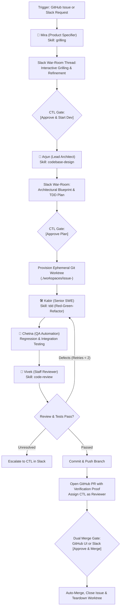
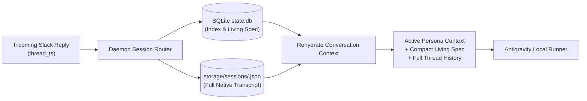

# Production Swarm Architecture & Workflow Specification

This document defines the high-level architecture, multi-agent lifecycle, session persistence model, and team personas for transitioning the proof-of-concept into a resilient, production-ready autonomous engineering team.

---

## 1. Executive Summary & Design Principles

The production swarm operates as an asynchronous, event-driven engineering department supervised by the Chief Technology Lead (CTL) across GitHub and Slack.

### Core Invariants
1. **Zero-API-Key Host Auth**: Cloud inference runs through the local `google-antigravity` host binary inheriting active subscription OAuth credentials.
2. **Dhruv Quota Governance**: All turns are metered against task ceilings (`150,000` tokens / `15` turns default) with runtime `@post_turn` halts.
3. **Workspace Isolation**: Production repo files are never touched directly; each task executes in `./workspaces/issue-<id>`.
4. **Human Peer Communication**: Agents speak as real colleagues (2–4 concise sentences, natural tone, zero robotic preamble).

---

## 2. Agent Team Roster & Personas

| Avatar | Persona & Name | Role | Primary Skills & Tools | Tone / Voice |
| :---: | :--- | :--- | :--- | :--- |
| 🎯 | **Mira** *(Product Specifier)* | Issue intake, requirement grilling, edge-case probing, acceptance criteria | `grilling`, GitHub API, Slack Bolt | Inquisitive, structured, sharp. Probes ambiguities until assumptions vanish. |
| 🧭 | **Arjun** *(Lead Architect)* | System design, file boundaries, dependency planning, TDD test strategy | `codebase-design`, AST search, git log | Senior, pragmatic, trade-off oriented. Explains *why* before *what*. |
| 🛠️ | **Kabir** *(Senior SWE)* | TDD implementation (Red-Green-Refactor), clean coding, commit hygiene | `tdd`, file editor, git worktree | Direct, builder-focused, concise. Reports code diffs and decisions. |
| 🔬 | **Chetna** *(QA Automation)* | Regression suites, edge-case test generation, reproduction proofs | `pytest`, `vitest`, linters, curl | Skeptical, thorough. Demands reproducible proof for every assertion. |
| 🧐 | **Vivek** *(Staff Reviewer)* | Dual-axis review (Standards + Spec adherence) before commit | `code-review`, git diff, static analysis | Constructive, candid, quality-focused. Blocks sloppy code and scope creep. |
| ⚖️ | **Dhruv** *(Quota Guard)* | Real-time token metering, turn ceiling tracking, approval gates | SQLite state store, Slack Block Kit | Neutral, alert, policy-bound. Warns before quota limits are reached. |

---

## 3. End-to-End Task Lifecycle

### Phase 1: Intake & Requirements Grilling
1. **Dual Entry Triggers**:
   - **GitHub**: New or existing issue tagged with label `triage:agent` or `needs-spec`.
   - **Slack**: CTL drops a request or types `/agent solve <request>` in `#agent-ops`.
2. **Immediate Linkage**:
   - Mira creates a Draft GitHub Issue (`[Draft] <Title>`) if triggered from Slack, or links existing issue.
   - Spawns a dedicated Slack War-Room thread mapping `issue_id` ↔ `slack_thread_ts` ↔ `task_id`.
3. **Interactive Grilling**:
   - Mira interviews the CTL in the Slack thread using the `grilling` skill.
   - Asks pointed questions one round at a time to clarify boundaries, error conditions, and user expectations.
4. **Intake Gate (`[Approve & Start Implementation]`)**:
   - Once aligned, Mira summarizes the finalized acceptance criteria.
   - Posts a Block Kit card with `[Approve & Start Implementation]`.
   - CTL clicking approve updates the GitHub issue description to clean markdown and shifts label to `status:ready-for-dev`.

---

### Phase 2: Architectural Planning & Sign-Off
1. **Context Ingestion**:
   - Arjun picks up the task from the FIFO dispatch queue.
   - Inspects the target repository codebase using symbols, callgraphs, and tree tools.
2. **Plan Formulation**:
   - Arjun creates an `ImplementationPlan`:
     - Files to add / modify / delete.
     - Planned TDD test cases (what failing tests will be written first).
     - Known risks, dependencies, or potential regressions.
3. **Plan Approval Gate (`[Approve Plan]`)**:
   - Arjun posts a concise architectural blueprint directly into the Slack thread.
   - Awaits CTL action: CTL clicks `[Approve Plan]` or replies with steering feedback.
   - If steering feedback is provided, Arjun refines the plan and reposts.

---

### Phase 3: Test-Driven Development (TDD) Loop
1. **Worktree Provisioning**:
   - On plan approval, `WorktreeManager` provisions `./workspaces/issue-<id>` branched from the target repo base.
2. **Red Phase (Failing Test)**:
   - Kabir creates new test files or test cases verifying the required functionality.
   - Executes the test runner (`pytest`) to confirm tests fail as expected with legitimate errors.
3. **Green Phase (Implementation)**:
   - Kabir writes minimal production code inside the worktree to make the tests pass.
   - Runs tests until all new tests pass.
4. **Refactor Phase**:
   - Cleans up structure, names, and docstrings while preserving green test status.
5. **Chetna Regression Verification**:
   - Chetna executes the complete test suite across the repository to ensure zero regressions in unaffected modules.

---

### Phase 4: Pre-Commit Review & Verification Gate
1. **Dual-Axis Review (Vivek)**:
   - Vivek inspects the unified worktree diff along two axes:
     - **Standards**: Repo idioms, style, type annotations, error handling, security.
     - **Spec**: Does the code faithfully implement what was agreed in Mira's spec without drift?
2. **Defect Feedback Loop**:
   - If blocking defects are found, Vivek posts concise actionable feedback to Kabir.
   - Kabir applies fixes (up to 2 automatic retry loops).
   - If still unresolved, Vivek alerts CTL in Slack for guidance.
3. **Commit & Push**:
   - Once Vivek signs off, Kabir stages, creates clean semantic commits (`feat(scope): ...`), and pushes the branch to remote origin.

---

### Phase 5: Delivery, Verification Proof & Dual-Channel Merge
1. **Pull Request Assembly**:
   - Swarm opens a GitHub Pull Request via `gh pr create`.
   - Attaches a standardized **Verification Proof** section:
     - Step-by-step local verification command (`gh pr checkout <num> && ...`).
     - CLI / E2E execution output demonstrating successful execution.
     - Edge cases tested and test execution summary.
   - Assigns CTL as the PR reviewer.
2. **Slack War-Room Notification**:
   - Vivek announces the PR in the Slack thread with a direct link and diff stats.
   - Renders interactive Block Kit button: `[Approve & Merge PR]`.
3. **Dual-Channel Closure**:
   - **Path A**: CTL clicks `[Approve & Merge PR]` in Slack → daemon runs `gh pr merge --squash --delete-branch`, closes GitHub issue, and cleans up worktree.
   - **Path B**: CTL reviews and merges on GitHub.com → daemon poller detects merge event, posts confirmation in Slack, and tears down the worktree.

---

## 4. Session, State & History Architecture

To ensure uninterrupted continuity when replying to older threads or recovering from daemon restarts, the system uses a **Hybrid State & Trajectory Persistence Model**.

### 1. Storage Components
- **Index (`storage/state.db`)**:
  - `tasks`: Maps `task_id` ↔ `issue_id` ↔ `slack_thread_ts` ↔ `status` ↔ `branch_name` ↔ `budget_limit` ↔ `current_tokens`.
  - `living_specs`: Stores the current agreed requirements, architectural decisions, and review state in compact JSON.
  - `slack_events`: Immutable audit ledger of all inbound/outbound Slack events.
- **Native Trajectory Store (`storage/sessions/<task_id>.json`)**:
  - Full serialized turn history with prompt tokens, thoughts, tool inputs, tool outputs, and assistant replies.

### 2. Thread Rehydration Flow
When the CTL replies to *any* historical Slack thread:
1. **Lookup**: Daemon extracts `thread_ts`, queries `state.db` to retrieve the corresponding `task_id` and active lifecycle phase.
2. **Session Deserialization**:
   - If the task is active in memory, the message is queued immediately.
   - If the task is dormant or the daemon just restarted, `SessionManager` reads `<task_id>.json` from disk and rehydrates the conversation trajectory into the runner.
3. **Context Injection**:
   - The user message is appended with full chronological context.
   - The "Living Spec" is injected into system context so critical requirements are never lost to context truncation.
4. **Persona Dispatch**:
   - If the user @mentions a persona (e.g. `@Kabir`), that persona answers.
   - Otherwise, the persona mapped to the current lifecycle phase (Mira, Arjun, Kabir, Vivek) responds naturally.

---

## 5. Communication Guardrails & Team Persona Rules

Every agent persona adheres to strict behavioral instructions:
1. **Length**: Maximum 2 to 4 sentences per message unless providing an architectural spec or test log.
2. **Tone**: Collegial, pragmatic engineering peers speaking in the first person (`"I examined the Fibonacci helper..."`, `"Should we handle negative inputs by raising ValueError or returning None?"`).
3. **No Fluff**: No robotic apologies, sycophancy, or generic agent filler (`"As an AI language model..."`, `"Certainly, I will now proceed to..."`).
4. **Actionable Questions**: When asking for guidance, present concrete options with a clear recommendation.

---

## 6. Slack Space & Channel Management Architecture

To maintain high signal-to-noise ratio and prevent zombie UI states across tasks:

### 1. Channel Topology & Segmentation
Supports two operating modes via environment configuration:
- **Compact Mode (Default / Low Volume)**: All task lifecycles operate in `#agent-ops` with root cards and dedicated task threads (`thread_ts`).
- **Segregated Mode (High Volume / Production)**:
  - `#dev-triage`: Intake discussions, requirement grilling with Mira, acceptance criteria sign-offs.
  - `#dev-war-room`: Active implementation threads, Arjun's architectural plans, Kabir's TDD status, Chetna's regression logs, and Vivek's pre-commit reviews.
  - `#dev-releases`: Pull request delivery announcements, verification proofs, and CTL merge gates.

### 2. In-Place Block Kit Mutation (Zero Zombie Buttons)
- When a human clicks any Block Kit button (`[Approve Plan]`, `[+50k Tokens]`, `[Approve & Merge PR]`):
  - Daemon acknowledges immediately via `ack()`.
  - Mutates the original message in-place via `client.chat_update()`, removing the interactive button block and replacing it with a permanent, timestamped audit block (`✅ Approved by @user at 14:32:10 UTC`).
  - Eliminates accidental double-clicks and confusing historical button states.

### 3. Virtual Persona Routing & Name Disambiguation
- Because all agents operate under a unified Slack app token via `chat:write.customize`:
  - Incoming messages are passed through a regex scanner checking for explicit virtual mentions (`@Mira`, `@Arjun`, `@Kabir`, `@Chetna`, `@Vivek`, `@Dhruv`).
  - If a persona match is found, the daemon routes the turn specifically to that persona regardless of the current phase.
  - If no explicit persona is tagged, the turn defaults to the persona leading the active lifecycle phase.
